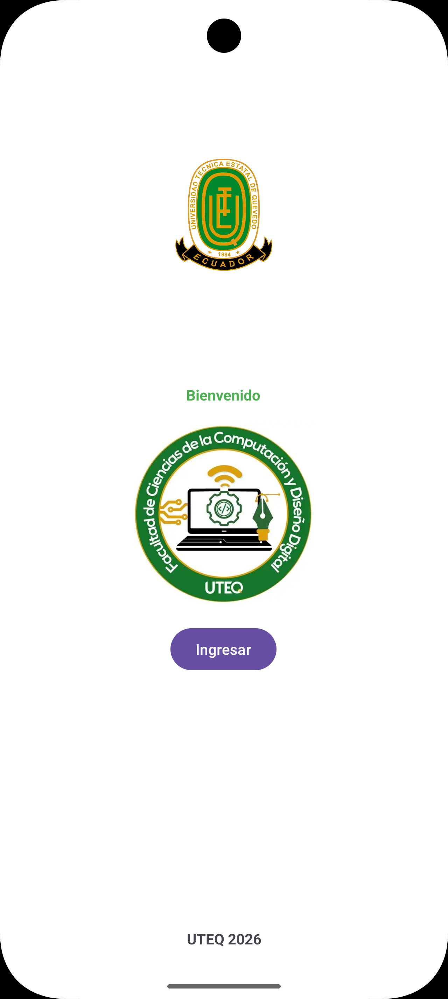
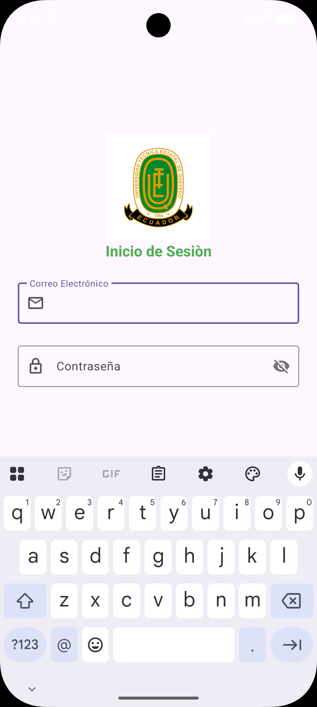

# AndroidStudio_Prac_Login
# Práctica: Inicio de Sesión (Login) en Android Studio

**Asignatura:** Aplicaciones Móviles  
**Docente:** Ing. Cristian Gabriel Zambrano Vega  
**Estudiante:** Fred Adrián Beltrán Montiel  
**Curso:** 6to Software "A" – Universidad Técnica Estatal de Quevedo (UTEQ)

## Descripción
Práctica guiada de la Semana 1 en la que se diseña la interfaz de una aplicación Android con dos pantallas, usando `ConstraintLayout` y componentes de Material Design:

- **Pantalla de bienvenida (`MainActivity`):** muestra el logo de la UTEQ, el texto "Bienvenido", el logo de la Facultad de Ciencias de la Computación (FCC), el botón **Ingresar** y el pie "UTEQ 2026".
- **Pantalla de inicio de sesión (`actLogin`):** muestra el logo de la UTEQ, el título "Inicio de Sesión" y dos campos `TextInputLayout`:
  - **Correo electrónico**, con ícono de sobre y teclado para correos.
  - **Contraseña**, con ícono de candado y botón para mostrar u ocultar la contraseña.

Ambas actividades usan `WindowCompat.enableEdgeToEdge` y ajustan su relleno a las barras del sistema.

## Estructura del proyecto
```
app/src/main/
├── java/com/example/semana1_v/
│   ├── MainActivity.java        # Pantalla de bienvenida
│   └── actLogin.java            # Pantalla de inicio de sesión
├── res/
│   ├── layout/
│   │   ├── activity_main.xml       # Diseño de la bienvenida
│   │   └── activity_act_login.xml  # Diseño del login
│   └── drawable/
│       ├── logouteq.png   # Logo UTEQ
│       ├── logofcc.png    # Logo FCC
│       ├── mail.png       # Ícono del campo correo
│       └── candado.png    # Ícono del campo contraseña
└── AndroidManifest.xml
```

## Capturas de la interfaz

### Pantalla de bienvenida


### Pantalla de inicio de sesión


## Tecnologías utilizadas
- Android Studio Rabbit 2 (2026.2.2)
- Java 11
- Android Gradle Plugin 9.5.1 (Kotlin DSL para los scripts de Gradle)
- SDK mínimo 26 (Android 8.0) · SDK objetivo 37
- AndroidX AppCompat, ConstraintLayout y Material Components

## Cómo ejecutar
1. Clonar el repositorio:
   ```bash
   git clone https://github.com/JirachinG19Stdio/AndroidStudio_Prac_Login.git
   ```
2. Abrirlo en Android Studio y esperar la sincronización de Gradle.
3. Ejecutar en un emulador o dispositivo físico con Android 8.0 o superior.

## Estado
✅ Práctica completada.
